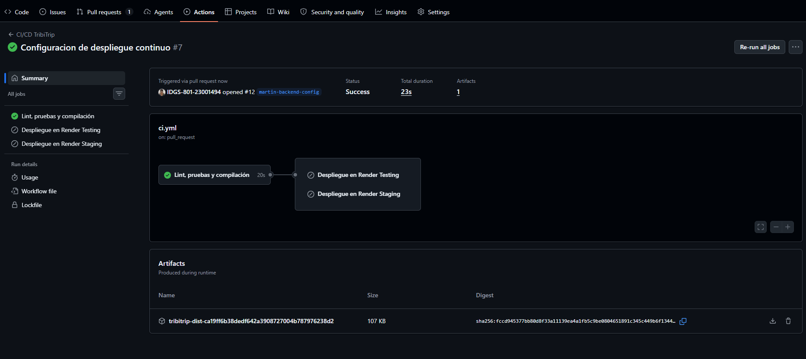
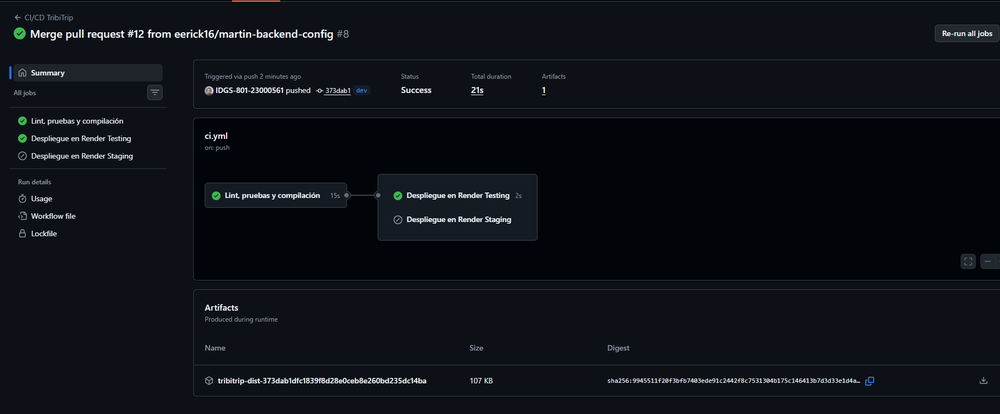
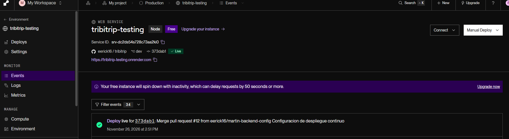
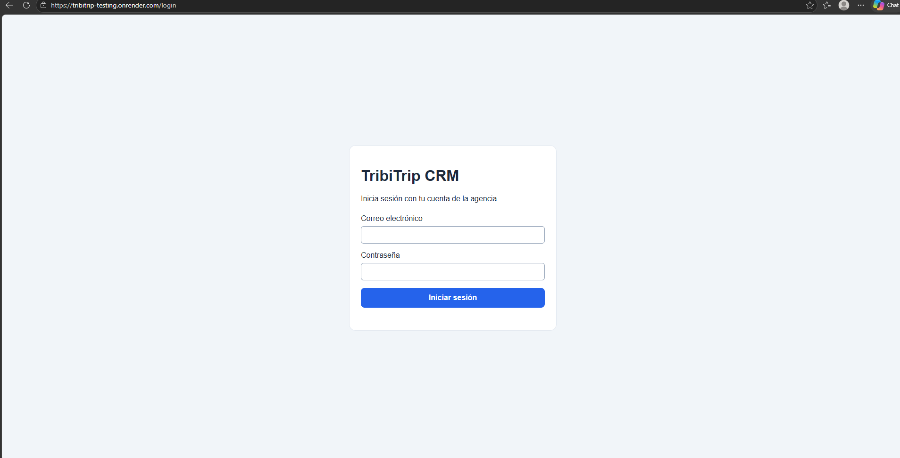
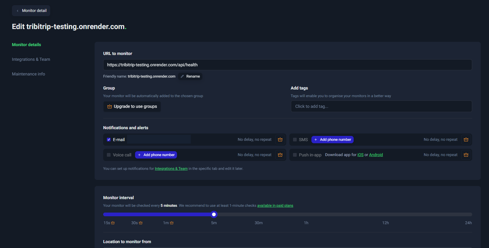
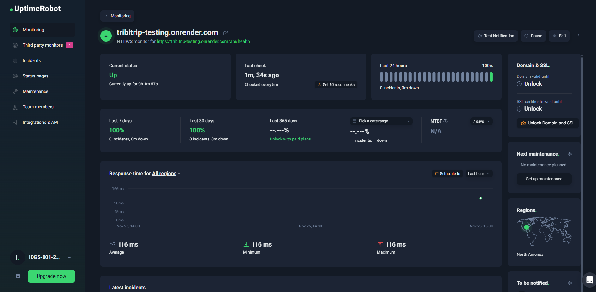
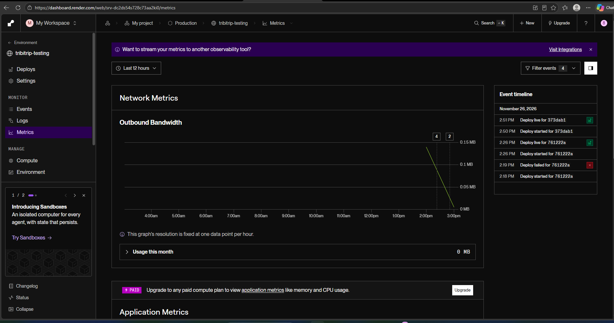
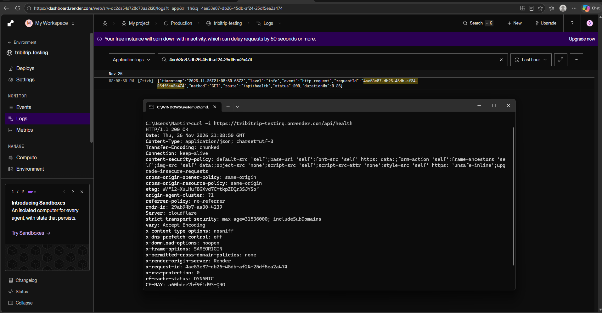

# Evidencias y validaciones

[Portada](../TribiTrip.md)

## Evidencias disponibles

Capturas del 26/11/2026, correspondientes a la integración, despliegue y monitoreo de Testing. No sustituyen las pruebas de QA.

### Evidencia 1. CI en PR #12

Ejecución #7 exitosa en 23 s; verificación de 20 s, artefacto de 107 KB y despliegues omitidos.

### Evidencia 2. CI/CD en dev

Ejecución #8 exitosa en 21 s, SHA `373dab1`, verificación de 15 s y solicitud de despliegue Testing de 2 s; Staging omitido. Artefacto de 107 KB.

### Evidencia 3. Despliegue efectivo

Render Events muestra Live para `373dab1` el 26/11/2026.

### Evidencia 4. Acceso a Testing

La pantalla de inicio de sesión carga por HTTPS. No acredita por sí sola autenticación exitosa.

### Evidencia 5. Configuración del monitor

Endpoint `/api/health`, intervalo de cinco minutos y notificación por correo habilitada. Dirección de correo ocultada.

### Evidencia 6. Muestra inicial

Estado Up, 100 % en la muestra inicial, 116 ms de respuesta, cero incidentes y cero minutos de caída. El monitor llevaba menos de dos minutos activo; no acredita un SLA mensual.

### Evidencia 7. Métricas de Render

Ancho de banda saliente; CPU y memoria requieren plan de pago.

### Evidencia 8. Correlación de solicitud

HTTP 200 y encabezado X-Request-ID coincidente con el registro de GET `/api/health`, status 200 y durationMs 0.36. El cuerpo JSON no aparece en esta captura.

## Evidencias de QA

Ejecuciones del 26/11/2026 en Ciudad de México. Los registros UTC de rendimiento indican 27/11/2026.

- [Suite local de 21 pruebas](pruebas/unitarias.md#evidencia) y [alcance de integración](pruebas/integracion.md).
- [Análisis estático y compilación](pruebas/analisis-estatico.md#evidencias).
- [Auditorías de dependencias](pruebas/vulnerabilidades.md#evidencias).
- [Health y escenarios de Testing](pruebas/rendimiento.md#evidencias).

## Evidencias pendientes
 
Para cada evidencia, registrar el ambiente, fecha, SHA o versión cuando corresponda, referencia a la ejecución o captura y resultado observado.

| Ámbito | Evidencia o confirmación pendiente |
|---|---|
| CI | Adjuntar registros detallados por paso de la ejecución, incluyendo las 21 pruebas aprobadas. Las ejecuciones #7 y #8 y sus artefactos se muestran arriba. |
| Testing | Adjuntar configuración final redactada, confirmar base efectiva `test`, cuerpo JSON de health y acceso autenticado. Render Events, HTTP 200 y pantalla de login ya documentados. |
| Staging | URL y base efectiva `tribitrip`, ejecución efectiva del CD, liberación, Render Events, health, acceso y monitor. |
| UptimeRobot | Consolidar ventana de observación y confirmar recepción de alertas; muestra inicial y configuración adjuntas. |
| Render | Capturas de Metrics y correlación adjuntas; consolidar métricas del periodo. |
| QA | Comparación de regresión entre versiones, seguimiento del hallazgo de desarrollo, aceptación manual y validación del PDF. |
| Seguridad y operación | Confirmar índice y TTL en base de pruebas, política real de respaldos y restauración, protecciones de ramas, matriz de navegadores y tratamiento de datos históricos de contactos, si corresponde. |
| Publicación de la Wiki | Confirmar rama y repositorio de publicación, incorporación de `docs/`, vínculo a Wiki y evidencia de publicación. |
| Manual | Capturas reales de cada procedimiento con datos de demostración. |

## Validación de la Wiki de código

En el repositorio se comprueban los destinos relativos, las páginas padre, las carpetas homónimas y las entradas de `.order`, junto con la sintaxis de los bloques Mermaid. Los recursos y capturas se incorporan a `.attachments/` dentro de la raíz de publicación, con enlaces relativos y sin datos sensibles. Tras publicar `docs/`, comprobar portada, orden y jerarquía, destinos de enlaces entre niveles, renderizado Mermaid, capturas y páginas de QA. [Publicación de Wiki de código](https://learn.microsoft.com/en-us/azure/devops/project/wiki/publish-repo-to-wiki?view=azure-devops) · [Sintaxis Markdown y Mermaid](https://learn.microsoft.com/en-us/azure/devops/project/wiki/markdown-guidance?view=azure-devops)
