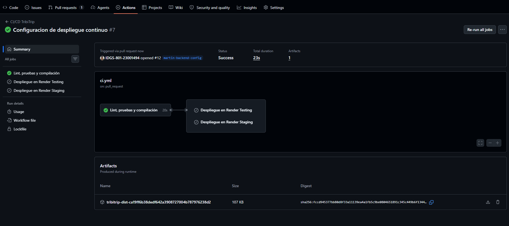
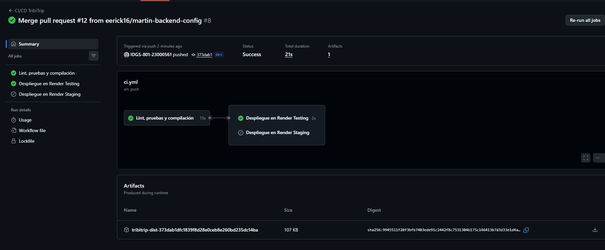

# Integración continua

[Portada](../TribiTrip.md) · [Despliegue continuo](despliegue.md) · [Pruebas](pruebas.md)

GitHub Actions ejecuta `.github/workflows/ci.yml` en PR y push hacia `dev` y `main`, y por `workflow_dispatch`. El job `verify` usa Ubuntu y Node.js 24. GitHub Actions obtiene el código y configura el runtime. npm instala las versiones del lockfile; ESLint aplica análisis estático, Vite compila la SPA y Node.js Test Runner ejecuta la suite de servidor.
 
| Orden | Etapa | Operación |
|---|---|---|
| 1 | Código | Checkout del commit. |
| 2 | Runtime | Node.js 24. |
| 3 | Frontend | `npm ci` |
| 4 | Backend | `npm --prefix server ci` |
| 5 | Análisis estático | `npm run lint` |
| 6 | Compilación | `npm run build` |
| 7 | Pruebas | `npm --prefix server test` |
| 8 | Artefacto | Publicar `dist/` como `tribitrip-dist-<SHA del commit>`. |

::: mermaid
graph LR
  E["PR, push o ejecución manual"] --> C["Checkout y Node.js 24"]
  C --> I["Instalar frontend y backend"]
  I --> L["ESLint"]
  L --> B["Compilar con Vite"]
  B --> T["Node.js Test Runner"]
  T --> A["Publicar artefacto"]
  A --> D["Push elegible habilita CD"]
:::

En la pestaña **Actions**, abrir el workflow, elegir la ejecución y revisar el SHA, el estado de los jobs, los registros por paso y el artefacto. En un PR, consultar las comprobaciones asociadas. Los jobs de despliegue esperan a que la verificación termine correctamente. Se reportó una ejecución con 21 pruebas aprobadas, lint satisfactorio y compilación correcta. Queda pendiente adjuntar el registro detallado de los pasos; las capturas de resumen se incluyen abajo. [Evidencias](evidencias.md)

Registrar el vínculo de la ejecución junto con el SHA y el artefacto correspondiente. [Registro de validaciones](evidencias.md)

## Evidencias de validación

### Evidencia 1. CI en PR #12

Ejecución #7 exitosa en 23 s; verificación de 20 s, artefacto de 107 KB y despliegues omitidos.

### Evidencia 2. CI/CD en dev

Ejecución #8 exitosa en 21 s, SHA `373dab1`, verificación de 15 s y solicitud de despliegue Testing de 2 s; Staging omitido. Artefacto de 107 KB.

