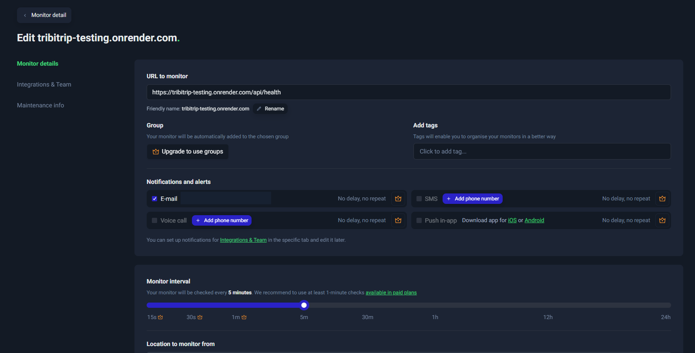
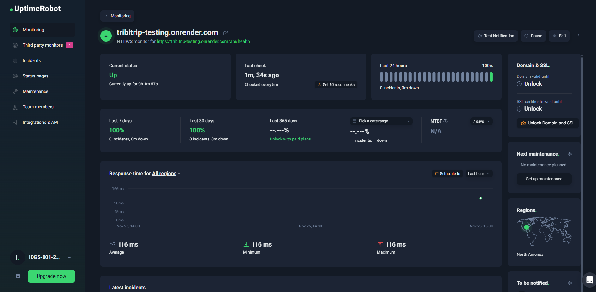
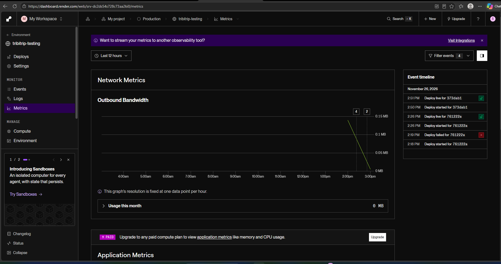
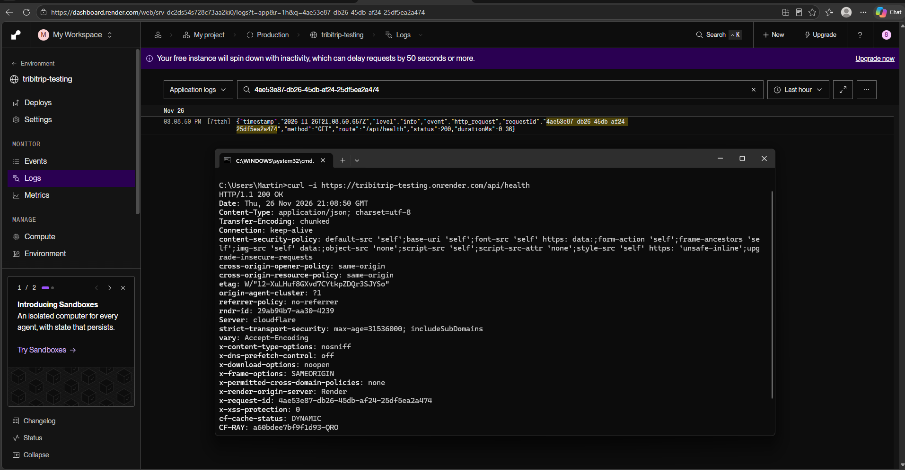

# Monitoreo y observabilidad

[Portada](../TribiTrip.md) · [Niveles de servicio](monitoreo/niveles-de-servicio.md) · [Planes de mejora](monitoreo/planes-de-mejora.md)

## Disponibilidad y salud

UptimeRobot verifica HTTP(s) cada cinco minutos desde Norteamérica con alertas por correo. El monitor se llama `TribiTrip - Testing` y evalúa disponibilidad HTTP. El monitor de Staging se configurará después de la liberación. [Endpoint monitorizado](https://tribitrip-testing.onrender.com/api/health)
 
`GET /api/health` es público. `server/app.js` consulta `mongoose.connection.readyState === 1`. Devuelve HTTP 200 con `{"conectado":true}` cuando la conexión está activa y HTTP 503 con `{"conectado":false}` en otro estado. La comprobación usa el estado de Mongoose, sin ejecutar una consulta funcional. La validación de Testing obtuvo HTTP 200. La captura correspondiente se incluye al final de esta página. El monitor HTTP se configura por estado de respuesta y la comprobación de JSON corresponde a la revisión posterior al despliegue.

## Métricas, logs y correlación

Render Metrics permite consultar ancho de banda saliente. El panel del plan gratuito consultado carece de métricas de CPU y memoria. En Render Logs, los eventos JSON incluyen `timestamp` UTC, `level`, `event`, `requestId`, `method`, `route` y, para `http_request`, `status` y `durationMs`. El servidor genera el ID y devuelve `X-Request-ID`. Para investigar una incidencia, capturar el ID y la hora con la respuesta, abrir los logs del servicio correspondiente y localizar el valor exacto. La correlación se verificó en Testing. La captura correspondiente se incluye al final de esta página.

`durationMs` mide el intervalo en el proceso desde el middleware hasta que termina la respuesta. El tiempo extremo a extremo medido desde el cliente incluye red y espera antes de que Express procese la solicitud. El mecanismo aporta correlación básica por solicitud del backend.

::: mermaid
graph LR
  M["UptimeRobot"] -->|"HTTP cada 5 min"| H["GET /api/health"]
  H --> D["Estado de conexión Mongoose"]
  N["Cliente"] --> A["Express"]
  A -->|"X-Request-ID"| N
  A -->|"JSON con requestId"| L["Render Logs"]
  R["Render Metrics"] --> B["Ancho de banda saliente"]
:::

El periodo académico real será inferior a un mes. Disponibilidad, latencia, incidentes y tiempo de inactividad quedan pendientes de consolidación. [Evidencias](evidencias.md)

## Evidencias de validación

### Evidencia 5. Configuración del monitor

Endpoint `/api/health`, intervalo de cinco minutos y notificación por correo habilitada. Dirección de correo ocultada.

### Evidencia 6. Muestra inicial

Estado Up, 100 % en la muestra inicial, 116 ms de respuesta, cero incidentes y cero minutos de caída. El monitor llevaba menos de dos minutos activo; no acredita un SLA mensual.

### Evidencia 7. Métricas de Render

Ancho de banda saliente; CPU y memoria requieren plan de pago.

### Evidencia 8. Correlación de solicitud

HTTP 200 y encabezado X-Request-ID coincidente con el registro de GET `/api/health`, status 200 y durationMs 0.36. El cuerpo JSON no aparece en esta captura.

