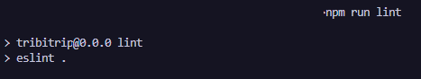
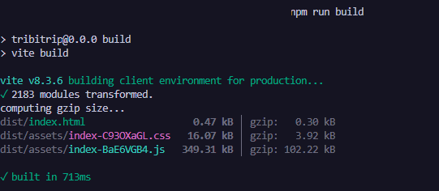

# Análisis estático y compilación

[Portada](../../TribiTrip.md) · [Pruebas](../pruebas.md) · [Evidencias](../evidencias.md)

## Objetivo y ambiente

Revisar el código con ESLint y compilar la SPA con Vite. [Ejecución local y SHA probado](../pruebas.md#ejecución-local).

## Procedimiento y resultados

| Comando | Resultado observado | Duración |
|---|---|---:|
| `npm run lint` | Ejecutó `eslint .` sin errores ni advertencias visibles | Sin dato |
| `npm run build` | Vite 8.3.6 transformó 2183 módulos y generó `dist/` | 713 ms |

## Evidencias

*Salida de npm run lint del 26/11/2026 en Windows 11.*

*Salida de npm run build del 26/11/2026 en Windows 11.*

## Limitaciones y conclusión

La compilación concluyó correctamente. El registro de origen deja sin documentar los códigos de salida y la duración de lint.
