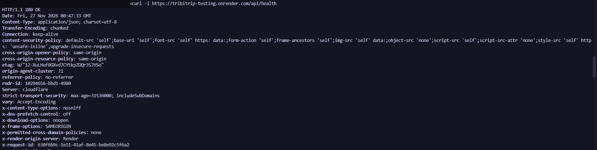
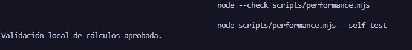

# Pruebas de rendimiento

[Portada](../../TribiTrip.md) · [Pruebas](../pruebas.md) · [Evidencias](../evidencias.md)

## Objetivo y ambiente

Medir latencia y errores de `GET /api/health` en Testing con Node.js v24.11.1, fetch nativo y Windows 11. El [registro de despliegue](../evidencias.md#evidencia-3-despliegue-efectivo) muestra `373dab1` activo ese día. La salida de rendimiento no registra el SHA remoto. Script en el repositorio `scripts/performance.mjs`. Su revisión local aún no tiene un commit registrado.

## Procedimiento registrado

La consulta previa respondió HTTP 200 a las 00:47:33 UTC del 27/11/2026. El Word registra el cuerpo `{"conectado":true}`. El script usa una pausa de 250 ms por trabajador. El registro deja sin documentar un calentamiento dedicado y la medición en frío.

```cmd
curl -i https://tribitrip-testing.onrender.com/api/health
node --check scripts/performance.mjs
node scripts/performance.mjs --self-test
node scripts/performance.mjs --url https://tribitrip-testing.onrender.com/api/health --concurrency 1 --duration 30 --timeout 5000
node scripts/performance.mjs --url https://tribitrip-testing.onrender.com/api/health --concurrency 3 --duration 30 --timeout 5000
node scripts/performance.mjs --url https://tribitrip-testing.onrender.com/api/health --concurrency 10 --duration 60 --timeout 5000
```

## Resultados

Los horarios del 27/11/2026 UTC corresponden al 26/11/2026 en Ciudad de México.

| Escenario | Inicio UTC | Concurrencia | Duración real (s) | Total | Éxitos | Fallos | Error % | req/s | Estado |
|---|---|---:|---:|---:|---:|---:|---:|---:|---|
| PR-01 | 00:56:58.231 | 1 | 30.11 | 83 | 83 | 0 | 0.00 | 2.76 | Aprobado |
| PR-02 | 01:01:38.054 | 3 | 30.16 | 253 | 253 | 0 | 0.00 | 8.39 | Aprobado |
| PR-03 | 01:07:20.582 | 10 | 60.20 | 1699 | 1699 | 0 | 0.00 | 28.22 | Aprobado |

| Escenario | Mín. (ms) | Media (ms) | Máx. (ms) | p50 (ms) | p95 (ms) | p99 (ms) |
|---|---:|---:|---:|---:|---:|---:|
| PR-01 | 91.94 | 103.50 | 574.51 | 95.88 | 111.57 | 574.51 |
| PR-02 | 88.10 | 100.08 | 384.28 | 93.63 | 111.51 | 341.42 |
| PR-03 | 87.23 | 97.63 | 568.05 | 92.57 | 111.43 | 169.63 |

Percentiles calculados por rango más cercano sobre respuestas exitosas. La salida registra cero fallos HTTP, de contenido, red o timeout en los tres escenarios.

## Evidencias



*GET /api/health en Testing con HTTP 200 el 27/11/2026 UTC.*



*Sintaxis y autoprueba de cálculos en la ejecución local.*

- PR-01 · [Resultados](../../.attachments/pruebas/rendimiento/pr-01-resultados.png) · [Evaluación](../../.attachments/pruebas/rendimiento/pr-01-evaluacion.png)
- PR-02 · [Resultados](../../.attachments/pruebas/rendimiento/pr-02-resultados.png) · [Evaluación](../../.attachments/pruebas/rendimiento/pr-02-evaluacion.png)
- PR-03 · [Resultados](../../.attachments/pruebas/rendimiento/pr-03-resultados.png) · [Evaluación](../../.attachments/pruebas/rendimiento/pr-03-evaluacion.png)

## Limitaciones y conclusión

Los tres escenarios cumplieron p95 ≤ 1000 ms y errores totales < 1%. El indicador de monitoreo HTTP usa 5xx sobre respuestas HTTP observadas. El script considera fallos totales por solicitud. Los resultados cubren únicamente la ruta health y las ventanas medidas. El arranque en frío, el resto del CRM y la disponibilidad mensual requieren mediciones propias. [Niveles de servicio](../monitoreo/niveles-de-servicio.md)
