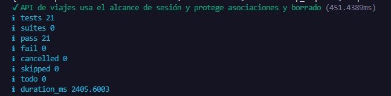

# Pruebas unitarias

[Portada](../../TribiTrip.md) · [Pruebas](../pruebas.md) · [Evidencias](../evidencias.md)

## Objetivo y alcance

Validaciones de modelos, cálculos, fechas, HTML imprimible, contraseñas y selección de host.

## Procedimiento

[Ejecución local y SHA probado](../pruebas.md#ejecución-local). Node.js Test Runner ejecutó `node --test` mediante el script del servidor.

```cmd
npm --prefix server test
```

## Resultados

**12 casos aprobados** en esta categoría. La ejecución combinada registró 21 aprobadas, 0 fallidas, 0 omitidas, 0 canceladas, 0 pendientes y una duración de 2405.6003 ms.

| Archivo | Comportamiento verificado | Resultado observado | Duración (ms) |
|---|---|---|---:|
| `app.test.js` | modelos rechazan contactos inválidos y roles desconocidos | Aprobado | 24.8984 |
| `commercial.test.js` | el periodo incluye ambos días en Ciudad de México y limita rangos | Aprobado | 3.2429 |
| `deployment.test.js` | el listener usa loopback local, todas las interfaces en Render y HOST explícito | Aprobado | 21.6675 |
| `opportunity.test.js` | oportunidad exige título, relaciones y etapa comercial válida | Aprobado | 17.1829 |
| `quote.test.js` | catálogo valida descripción, tipo y precio de referencia en centavos | Aprobado | 17.6838 |
| `quote.test.js` | cálculo en centavos y validación del modelo de cotizaciones | Aprobado | 47.6141 |
| `quote.test.js` | la vigencia incluye la fecha límite en la zona de Ciudad de México | Aprobado | 1.353 |
| `quote.test.js` | HTML imprimible contiene entre uno y cincuenta conceptos y los importes guardados | Aprobado | 2.3224 |
| `reservation.test.js` | modelo valida fechas, origen e importes y deriva el monto pagado | Aprobado | 78.8247 |
| `security.test.js` | hash con sal aleatoria y comprobación de contraseñas | Aprobado | 221.5785 |
| `travel.test.js` | solicitudes validan destino, calendario, orden, presupuesto y cantidad | Aprobado | 24.8189 |
| `travel.test.js` | viajeros validan datos y la solicitud no admite más viajeros que su capacidad | Aprobado | 22.3663 |

## Evidencia



*Resumen de Node.js Test Runner del 26/11/2026 en Windows 11.*


## Limitaciones y conclusión

Los casos de esta categoría aprobaron en la ejecución documentada. La revisión manual del PDF queda pendiente. [Trazabilidad](../analisis/trazabilidad.md)
