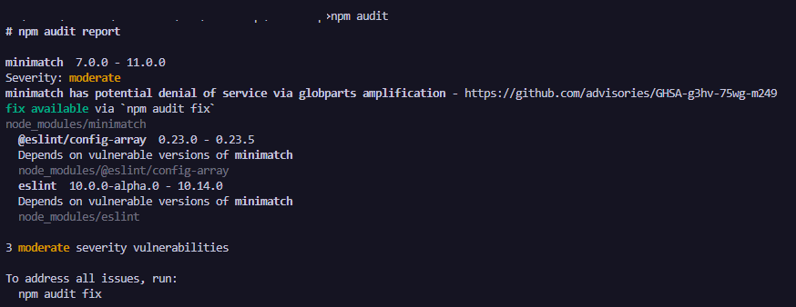
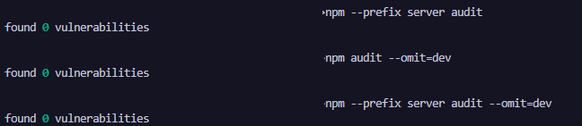

# Auditoría de dependencias

[Portada](../../TribiTrip.md) · [Pruebas](../pruebas.md) · [Evidencias](../evidencias.md)

## Objetivo y ambiente

Revisar dependencias del proyecto raíz y del servidor mediante npm audit. [Ejecución local y SHA probado](../pruebas.md#ejecución-local).

## Procedimiento y resultados

| Comando | Dependencias | Resultado observado |
|---|---|---|
| `npm audit` | Raíz, producción y desarrollo | 3 moderadas reportadas |
| `npm --prefix server audit` | Servidor, producción y desarrollo | 0 reportadas |
| `npm audit --omit=dev` | Raíz, producción | 0 reportadas |
| `npm --prefix server audit --omit=dev` | Servidor, producción | 0 reportadas |

El reporte raíz muestra `minimatch` como dependencia transitiva en la cadena de desarrollo de `@eslint/config-array` y `eslint`, con el aviso moderado `GHSA-g3hv-75wg-m249`. Las consultas de producción y las completas tienen alcances solapados.

## Evidencias

*Auditoría raíz del 26/11/2026 en Windows 11.*

*Auditorías de servidor y producción del 26/11/2026 en Windows 11.*

## Limitaciones y conclusión

Las cifras corresponden a los reportes de esa fecha. El hallazgo de desarrollo queda abierto para revisar una actualización compatible y verificarla con auditoría, lint, build y la suite.
